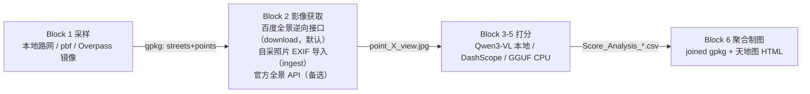

# SAGAI-CN · 街景生成式 AI 分析（国内版）

> 基于 [perezjoan/SAGAI](https://github.com/perezjoan/SAGAI)（Apache 2.0）的国内化改造实现。
> 把"这条街好不好走、绿不绿、安不安全"这类主观街景品质，用视觉语言大模型（VLM）批量量化成可统计、可制图的空间指标——**全链路在国内网络环境直接可用，无需任何境外服务**。

📖 **零基础用户请直接阅读 → [零基础上手指南](零基础上手指南.md)**（全程无术语、可复制照做）

## 与上游 SAGAI 的差异

| 环节 | 上游 SAGAI v2.3 | 本项目 |
|---|---|---|
| 运行环境 | Google Colab | 本地 / 国产云 Jupyter，纯 Python 包 + CLI |
| 街景影像 | Google Street View Static + Metadata API | **百度全景逆向接口**（无需 AK，高清全景切四视角，默认推荐；实现参考 [Baidu_StreetView_Download](https://github.com/Urbankernel/Baidu_StreetView_Download)）；自采照片导入（EXIF 定位）与官方静态图 API 为备选 |
| 模型权重 | Hugging Face Hub | **ModelScope 本地下载**（Qwen3-VL / Qwen2.5-VL / InternVL3.5） |
| 推理引擎 | UVLM（本地 GPU） | 路线 A：UVLM 本地（不变）；路线 B：**阿里云百炼 DashScope API**（无 GPU 备选）；路线 C：**GGUF + llama.cpp**（纯 CPU 本地，内置共识投票/CoT/续跑） |
| 路网数据 | Overpass API | 本地矢量路网 / 离线 .osm.pbf / Overpass 镜像端点，三选一 |
| 交互地图底图 | CARTO / OSM 瓦片 | **天地图**（CGCS2000，有审图号） |

功能与上游对齐：多视角采样（左/右/前/后）、canonical bearing、最多 10 个评分任务、numeric/category/boolean/text 四类任务、共识投票（2–5 次）、思维链 CoT、截断检测、断点续跑、点/街道两级聚合、交互 HTML 地图。

## 流水线架构



## 安装

```bash
# Python 3.11+，建议隔离环境
pip install -r requirements.txt -i https://pypi.tuna.tsinghua.edu.cn/simple

# 把 sagai_cn 注册为命令行工具（安装后可省略 python -m sagai_cn.cli 前缀）
pip install .

# 本地推理（路线 A，需 NVIDIA GPU）追加：
# 默认安装 CUDA 版 torch
pip install -r requirements-gpu.txt
```

**纯 CPU 本地打分（路线 C，GGUF + llama.cpp，无需显卡）**：无需额外 Python 依赖，按 [scripts/setup_cpu_engine.md](scripts/setup_cpu_engine.md) 下载 `llama-server` 与 GGUF 权重即可。

**离线安装 UVLM（路线 A 的推理引擎）**：分两步——先下载、再安装。

1. 下载离线包：到 UVLM 的 GitHub release 页 [perezjoan/UVLM/releases/tag/v4.0.0](https://github.com/perezjoan/UVLM/releases/tag/v4.0.0)，下载 v4.0.0 的「Source code (zip)」（即 `UVLM-4.0.0.zip`），放入项目的 `vendor/` 目录。
2. 安装：

```bash
pip install ./vendor/UVLM-4.0.0.zip
```

> Windows 注意：`bitsandbytes` 需其 Windows 构建（≥0.43）；装不上就改 FP16（`--precision fp16`）或走路线 B。

## 配置

```bash
cp .env.example .env   # 然后填写
```

| 环境变量 | 用途 | 申请 |
|---|---|---|
| `BAIDU_AK` | 百度全景静态图 API（仅 `--source api` 备选路线用），多个用英文逗号分隔轮换 | [百度地图开放平台](https://lbsyun.baidu.com/) |
| `TIANDITU_TK` | 交互地图底图 | [天地图控制台](https://console.tianditu.gov.cn/) |
| `DASHSCOPE_API_KEY` | 路线 B 云推理（无 GPU 时用） | [阿里云百炼](https://bailian.console.aliyun.com/) |
| `SAGAI_BASE` | 数据根目录兜底（默认 `./data`）；`sample` 默认跟随 `--area` 或 `--roads` 所在文件夹 | — |

## 快速开始（最小全流程）

```bash
# 1. 采样（推荐用项目自有路网；也可用 --pbf 离线包或省略走 Overpass 镜像）
#    数据默认落在 --area 或 --roads 所在文件夹（此处为 data/SH/），后续所有产物都跟着走；
#    也可用 --base 指定、或设 SAGAI_BASE 兜底
#    --area 可选：提供时采样后仅保留研究区内点位（删除区外点）；省略则沿整条路网布点
sagai_cn sample --area data/SH/study_area.gpkg --roads data/SH/roads.gpkg

# 2a. 获取影像 · 导入自采照片（备选：逆向抓不到、或需要最新现场实拍时用）
sagai_cn ingest --photos ./photos
#   无 GPS 的照片会生成 manual_coords.csv 补录模板 + ingest_pick_map.html 选点地图，
#   补录后加 --manual 重跑：sagai_cn ingest --photos ./photos --manual data/SH/StreetViewBatchDownload/manual_coords.csv

# 2b. 获取影像 · 百度全景逆向接口（默认推荐，无需 AK，高清全景切四视角；实现参考 Baidu_StreetView_Download）
sagai_cn download
#     --source api 切官方全景静态图 API（需 BAIDU_AK）；--pano-level 1~4 调清晰度（默认 3=4096×2048）
#     --crop-bottom/--crop-top 裁掉全景底部车顶/顶部天空（默认 0.4/0.0，均设 0 关闭裁剪）
#     --search-radius 就近搜索半径（米，默认 5）：采样点未必精确落在街景采集轨迹上，
#     坐标本身无街景时会自动搜附近最近的街景点；设 0 关闭就近搜索

# 3a. 打分 · 路线 A（本地 GPU，先预下载权重）
python scripts/download_models.py Qwen3-VL-8B-Instruct
sagai_cn infer --engine local \
    --model Qwen3-VL-8B-Instruct --tasks task/tasks.yaml --max-tokens 800

# 3b. 打分 · 路线 B（无 GPU，阿里云百炼）
sagai_cn infer --engine dashscope \
    --api-model qwen3-vl-plus --tasks task/tasks.yaml --max-tokens 800

# 3c. 打分 · 路线 C（纯 CPU 本地，GGUF + llama.cpp；先按 scripts/setup_cpu_engine.md 起服务）
sagai_cn download-models --gguf Qwen3-VL-8B-Instruct-GGUF
sagai_cn infer --engine cpu --tasks task/tasks.yaml --max-tokens 200

# 4. 聚合 + 5. 制图
sagai_cn aggregate --score-col green_view
sagai_cn map --score-col green_view
#    map 自动发现数据目录下的 roads.gpkg / study_area.gpkg（有几个画几个），
#    路网 + 研究范围作为可勾选图层；也可 --roads/--area 显式指定
```

产物（默认落在 `--area` 或 `--roads` 所在文件夹）：

```
data/XXX/
├── StreetSamples/street_samples.gpkg        # streets + points 两层
├── StreetViewBatchDownload/
│   ├── point_1_XX路_20190519_left.jpg ... # 逆向下载：文件名含路名+拍摄时间
│   │                                         #   （自采照片路线仍为 point_1_left.jpg）
│   ├── download_report.csv                  # 每张图的状态、路名、拍摄时间与覆盖率
│   └── Score_Analysis_{model}.csv           # 每模型一个评分文件
└── Spatial_Results/
    ├── joined_{score_col}.gpkg              # 挂接全部统计列（EPSG:4326）
    ├── points_map_{score_col}.html          # 点级专题图（弹窗内嵌街景，含路网/研究范围图层）
    └── streets_map_{score_col}.html         # 街道级专题图
```

数据目录定位规则（优先级从高到低）：`--base` 参数 → `sample` 取 `--area` 所在文件夹（无 `--area` 时退 `--roads` 所在文件夹）→ 其余命令自动发现 `./data` 下唯一 case 目录 → `SAGAI_BASE` 环境变量 → `./data`。多个 case 目录并存时，后续命令需用 `--base` 明确指定。


## 百炼可选视觉理解模型（路线 B）

`infer --engine dashscope --api-model <模型名>` 的模型名可自由替换——`--api-model` 无白名单，直接透传给百炼的 OpenAI 兼容接口，百炼所有视觉理解模型都能用。街景打分是短输出任务，优先选视觉理解（VL）系列：

| 模型名 | 定位 | 建议 |
|---|---|---|
| `qwen3-vl-plus`（默认） | 视觉理解旗舰，感知识别最强 | 首选；样本量不大或追求最高准确率 |
| `qwen3-vl-flash` | 轻量快速、性价比高 | 大批量控成本时推荐，先抽 10~20 张与 plus 对分再定 |
| `qwen-vl-plus` | 上一代（Qwen2.5-VL）均衡版 | 与上游 SAGAI 结果对照时用 |
| `qwen-vl-max` | 上一代最强 | 一般用不到，慢且贵 |
| `qwen-vl-ocr` | 专门 OCR/文档解析 | 不适合通用场景打分 |
| `qwen3-omni-flash` | 全模态（音视频交互） | 不建议，性价比不如专门 VL |

> 模型上下线较频繁，`--api-model` 报「model not found」时以百炼控制台「模型广场」当前列表为准；老一代 `qwen-vl-plus` / `qwen-vl-max` 已逐步被 qwen3 系列取代。

## 任务定义（tasks.yaml）

任务定义用 YAML 编写——`#` 开头即注释，可直接给每个键值对写解释文字。完整 10 个任务示例见 `task/tasks.yaml`，文件头部附有全部字段说明与硬规则。

```yaml
# 每个任务：column / prompt / task_type 必填；
# theory / fmt / advanced_reasoning / consensus_enabled / consensus_runs / numeric_tolerance 可选。
- column: green_view            # 任务列名 = CSV 列名 = --score-col 引用名
  prompt: 估算画面中植被（行道树、灌木、草地）占整个视野的面积百分比。只输出一个 0-100 的整数。
  task_type: numeric
  theory: 植被指活的绿色植物（行道树、灌木、草地等），不含绿色广告牌、涂料墙面等非植物。
  consensus_enabled: true       # 三票共识，更稳但费用×consensus_runs
  consensus_runs: 3
  numeric_tolerance: 20         # 估算类 20；数数类建议 30~50

- column: interface_vitality
  prompt: 评价街道临街底层界面的活跃度。只能从以下三项中选择一个回答：活跃、中性、封闭。
  task_type: category

- column: overall_impression
  prompt: 用一句话描述这条街道给人的整体氛围和第一印象。
  task_type: text
```

`column` 即任务列名（语义化英文名），`--score-col` 直接引用它。`task_type` ∈ `numeric / category / boolean / text`；text 任务不支持 CoT 与共识（与上游一致）。评分 prompt 中英文均可，国产模型下中文更稳。

**参数设置要点（实测踩坑总结）：**

- **`--max-tokens` 要给足**：默认 50 只够直接报数。任何任务开了 `"advanced_reasoning": true`（CoT）就必须加大，推荐 `--max-tokens 800`——CoT 先写分析再给结论，token 不够会在分析段被截断，此时兜底解析规则可能把"1. 识别图像内容"这类**序号数字误当成最终答案**。验收方法：查结果 CSV 的 `task_X_truncated` 列，为 1 即被截断、该列分数不可信。
- **`numeric_tolerance` 是百分比，数数类任务要放宽**：共识判定为"多次回答落在 中位数×(1±容差%) 内"。对小整数计数（如店面 3/4/5 家），20% 容差意味着 4±0.8，相邻整数永远形不成多数 → 输出 NA。计数类任务建议设 **30~50**；估算类（宽度、面积）用 20 即可。NA 也可视作"模型意见不一致"的信号加以利用。
- **改考题/参数后重跑要先删旧 CSV**：续跑按 `image_name` 跳过已完成行，不删除旧的 `Score_Analysis_*.csv` 则旧分数原样保留。

## 自采照片导入（ingest）说明

`ingest` 为自采照片导入路线（逆向抓图不可达、或需要最新现场实拍时用）：

- **EXIF 定位**：读取照片 GPS 经纬度（手机/相机开定位拍摄即自带），吸附到最近采样点，默认阈值 50 m（`--snap-max` 可调）；EXIF 含拍摄方向时，结合街道走向自动归入 left/right/front/back 中最近的视角，无方向信息时按空位分配。
- **逐张校验**：每张照片给出状态——`ok` / `ok_manual` / `no_gps` / `unmatched` / `duplicate` / `bad_file` / `unsupported` / `already_imported`，全部写入 `ingest_report.csv`；重复执行自动跳过已导入文件（幂等）。
- **缺 GPS 两种补录**：自动生成 `manual_coords.csv` 模板和 `ingest_pick_map.html` 选点地图——填经纬度，或在地图上查到 point_id 直接填入，然后 `--manual` 重跑。
- **格式**：jpg/jpeg/png/webp/tif/bmp 统一转存为 JPG；HEIC 需 pillow-heif（或手机端转 JPG）；无法解析的文件给明确原因，不中断批处理。
- 影像按 `{point_id}_{view}.jpg` 契约落盘，与百度下载产物完全同构，下游模块零改动。


## 已知限制

- 百度全景在郊区/新城覆盖显著弱于城区；`download` 结束会打印点位覆盖率，**低于 50% 的区域结果慎用**。方向校准依赖 `qt=sdata` 接口的采集车 Heading（每点多一次请求）；该接口偶发失败时退化为不修正并打印警告，`download_report.csv` 的 `car_heading` 列可审计。**升级方向校准前下载的四方向图方向有偏，需删除后重跑**（`panorama` 整图不受影响）。
- 逆向接口无 AK、无日配额，但受服务端风控：保持默认 `--interval`（瓦片间隔）避免限速；`--pano-level 4` 请求量/存储/风控风险 4 倍且 VLM 会预缩放，无精度收益，不推荐。
- 路线 A 需要 NVIDIA GPU（7B/8B 4bit 约 6–8 GB 显存）；无 GPU 走路线 B（云 API）或路线 C（纯 CPU 本地 GGUF，见 [scripts/setup_cpu_engine.md](scripts/setup_cpu_engine.md)）。
- 上游 LLaVA-NeXT / Gemma 模型无国内官方镜像，本项目不内置；Qwen3-VL / InternVL3.5 覆盖同等能力。

## 合规声明

- 街景原始图受百度服务条款约束，**不得对外发布原始影像**；对外成果只发布评分 CSV 与聚合图层（沿用上游对 Google 影像的处理方式）。逆向接口（`--source reverse`）仅供研究内部分析，请勿用于商业发布或大规模对外传播。
- 公开发布地图成果时，请使用有审图号的天地图底图并遵守《地图管理条例》。
- OSM 数据许可为 ODbL 1.0；百度/天地图/阿里云服务各有其使用条款，商用前请确认。

## 测试

```bash
python tests/smoke_test.py   # 无需 GPU/网络/key：采样→聚合→制图全链 + 脏数据用例
```

## 引用与致谢

上游项目（ Apache 2.0 ）：

> Perez, J. and Fusco, G. (2025). *Streetscape Analysis with Generative AI (SAGAI): Vision-Language Assessment and Mapping of Urban Scenes*. Geomatica, 77(2), 100063.

- 推理引擎 [UVLM](https://github.com/perezjoan/UVLM)（Apache 2.0）
- 百度街景下载（逆向接口）参考 [Baidu_StreetView_Download](https://github.com/Urbankernel/Baidu_StreetView_Download)（Apache 2.0）
- 模型：Qwen2.5-VL / Qwen3-VL（Apache 2.0）、InternVL3.5（MIT）

本项目同样以 Apache 2.0 发布，见 [LICENSE](LICENSE)。
